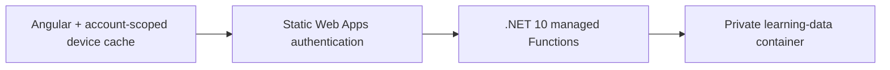

# Per-user Azure learning storage

EngineeringAtlas now uses **.NET 10 isolated Azure Functions** and **private Azure Blob Storage** for signed-in learning data. A browser cache remains available for queued edits and interrupted connections.

The user-facing guide and exercises are available at `/#/storage-lab`; their source is `public/azure-storage-lab.md`.

## Architecture



Static Web Apps checks GitHub sign-in and the `atlas_reader` role. The API checks the forwarded principal again, derives an opaque prefix from the provider and app-specific user ID, validates the document, and uses an atomic ETag condition for a save. No user ID from a JSON body controls the blob path. A client account fingerprint is checked on writes to prevent an old browser queue from being submitted under a different newly signed-in account.

The API must remain a **managed Static Web Apps API**. The forwarded-principal pattern is not authentication for an independently exposed public Functions endpoint.

## Resources and settings

- Resource group: `rg-engineering-atlas`
- Storage account: `statlaslearne76c5290`, East US 2, Standard LRS
- Container: `learning-data`, no anonymous access
- HTTPS and TLS 1.2 required; seven-day blob soft deletion enabled
- API runtime: `dotnet-isolated:10.0`
- API-only settings: `ATLAS_STORAGE_CONNECTION_STRING`, `ATLAS_STORAGE_CONTAINER`

The connection string is held in Azure application settings. It is never in Angular, GitHub source or a build artifact. `infra/Provision-Storage.ps1` provisions the account, container and settings without printing credentials or writing them to disk. It preserves existing API settings. The managed API's storage connection is key-based because this hosting mode does not provide a general-purpose managed identity for storage access. A separately hosted managed-identity API is a useful later exercise.

Blob capacity and operations are usage-based. The existing Free Static Web App hosts the managed API; its applicable service quotas still apply. Blob soft deletion is a recovery aid, not an independent backup.

## Documents and API

```text
learning-data/users/<owner-hash>/progress.json
learning-data/users/<owner-hash>/courses/<conversation-id>.json
```

| Endpoint | Methods | Purpose |
|---|---|---|
| `/api/learning/session` | GET | Signed-in account fingerprint and display name |
| `/api/learning/progress` | GET, PUT | Workspace progress, notes, takeaways and reading positions |
| `/api/learning/courses` | GET | This user's imported course IDs and versions |
| `/api/learning/courses/{id}` | GET, PUT | One imported course document |

GET returns the document and ETag. PUT requires `If-Match` for an existing document, or `If-None-Match: *` for a first save. Stale versions return `409`; missing version conditions return `428`. Documents are limited to 5 MB per request, and IDs and record types are validated. Unknown course IDs and cross-account fingerprints are rejected.

The app sends cookies only to its own origin. Storage credentials never leave the API. Cross-origin access is not opened. The custom owner header and JSON-only PUT methods also prevent ordinary cross-site form submissions from mutating data.

## Sync and migration

- On startup, the app establishes the signed-in scope before showing personal content. It loads Azure progress and lists available imported courses.
- Edits are written to an account-scoped device cache, then uploaded after a short debounce. **Saved to Azure** confirms the server accepted the save. Opening another device, returning focus, reconnecting, or selecting **Sync now** refreshes data.
- Queued device edits are retained across reloads. If Azure has a different version, the UI keeps the device copy and asks which version to retain. It does not silently merge competing note text. Export a progress backup before intentionally replacing a version.
- Imported courses are separate documents. An unsuccessful upload stays queued. A stale course upload is kept locally; reimporting the source while online deliberately replaces the current Azure text using its latest version condition.
- **Upload browser data to my account** is an explicit one-time migration from the old unscoped local storage and IndexedDB. Old browser copies are retained. Matching records and courses use the uploaded browser copies; unrelated cloud records are kept.
- Upload existing data from the browser and hostname where it was originally saved. Different hostnames have different browser caches. Once uploaded, both hostnames of the same Static Web App use the same server-side identity.
- Clearing a cache does not delete Azure records. Revoking and reinviting a user changes their app-specific identity; an administrator must deliberately migrate their older storage prefix if needed.

There is no real-time collaborative editing or multi-user sharing. The app can queue edits while already open offline, but it is not an installable offline site and does not promise a fresh offline launch. Wait for confirmed Azure status before depending on a change being present on a different device.

## Build, tests and local development

Install Node.js from `.nvmrc` and .NET 10 SDK. The existing Nx project has `api-build` and `api-test` targets.

```powershell
npm ci
npm test
npm run test:api
npm run build
npm run build:api
node scripts/verify-azure-deployment.cjs dist/engineering-atlas/browser dist/api
```

`npm start` remains browser-only when run on localhost without the managed API. To emulate the full auth/API locally, use Azure Functions Core Tools with the Static Web Apps CLI, and keep any local settings in the ignored `local.settings.json` file. Never expose a locally emulated principal as production authentication.

The Azure workflow builds and tests the client and .NET API, uploads them as separate artifacts, then deploys both without rebuilding. Hidden `.azurefunctions` extension files are included in the API artifact. Pull requests run API tests as well as client tests.

`api.tests` covers identity/role rejection, account isolation, validation, conditional versions and function registration. `api.smoke` exercises the real Blob SDK through the application API core using a random temporary identity. Its cleanup touches only that identity's prefix. Supply its connection string through the process environment, never an argument or a committed file.

## Learning follow-ups

1. Compare object storage with SQL, Table Storage and Cosmos DB for the current access patterns.
2. Replace server-side keys with managed identity on a separately hosted API.
3. Add structured metrics for sync latency, conflicts and retries without logging notes or course text.
4. Design retention and an independent recovery plan.
5. Decide whether per-record progress documents or a database would improve concurrent editing.

Official references: [managed APIs](https://learn.microsoft.com/azure/static-web-apps/apis), [user identity](https://learn.microsoft.com/azure/static-web-apps/user-information), [.NET isolated Functions](https://learn.microsoft.com/azure/azure-functions/dotnet-isolated-process-guide), [Blob concurrency](https://learn.microsoft.com/azure/storage/blobs/concurrency-manage).
